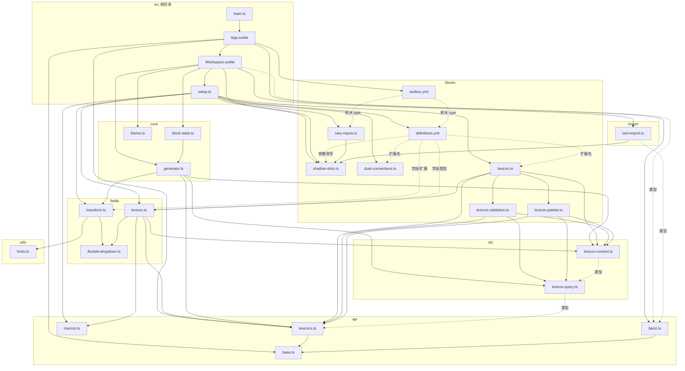

# ZiBlock

用积木拼出[填字（Tianzi）](https://tianzi.hongbot.icu/howto)指令的网页编辑器。

画布上的每个积木都是一个字符串表达式；每个顶层积木生成一行，按顺序拼成一段填字 DSL，
既可以在右侧直接查看生成的文本，也可以发给 Tianzi 服务执行并显示结果。
反过来，粘贴一段填字文本，也能通过服务端返回的语法树还原成积木。

## 技术栈

- **Svelte 5**（runes）+ **TypeScript**
- **Vite 8** 构建，`@modyfi/vite-plugin-yaml` 加载积木定义
- **Blockly 13** 提供画布、飞出菜单与序列化
- **runed** 的 `resource` 负责编译结果请求与去抖/取消
- 包管理器：**Bun**

## 快速开始

```sh
bun install
bun run dev       # 开发服务器
bun run build     # 生产构建
bun run preview   # 预览构建产物
bun run check     # svelte-check + tsc
```

开发模式下画布会暂存在 `sessionStorage`（`ziblock:workspace`），刷新页面不丢失；
该持久化只在 Vite HMR/开发模式启用。

## 目录结构

源码按职责分成 **blocks / core / dsl / fields / api / import / utils** 七个目录，
没有 `lib/` 包装层，也没有按功能命名的 `lexicons/`。

```
src/
├── main.ts                      挂载入口
├── App.svelte                   应用外壳：画布、编译结果面板、文本导入对话框
├── app.css                      全局变量与基础样式
├── Workspace.svelte             Blockly 画布组件
├── setup.ts                     Blockly 初始化与积木注册入口
├── blocks/                      积木定义、注册与画布交互
│   ├── definitions.yml          全部静态积木定义
│   ├── toolbox.yml              工具箱分类
│   ├── shadow-slots.ts          字段 → 值槽 + 字面量影子积木
│   ├── nary-inputs.ts           choice / reduce_calc / map 动态多路输入
│   ├── dual-connections.ts      表达式积木兼作语句
│   ├── lexicon.ts               词库积木与查询积木的扩展
│   ├── lexicon-palette.ts       查询条件齿轮气泡
│   └── lexicon-validation.ts    查询积木的警告与跨块校验
├── core/                        Blockly 生成器与运行状态
│   ├── generator.ts             填字 DSL 生成器（Blockly.Generator）
│   ├── block-state.ts           无代码积木自动置灰
│   └── theme.ts                 画布主题
├── dsl/                         与 Blockly 解耦的 DSL 模型
│   ├── lexicon-query.ts         查询 DSL 构造、校验与表达式渲染
│   └── lexicon-context.ts       查询积木在积木树中的上下文
├── fields/                      自定义 Blockly 字段
│   ├── flexible-dropdown.ts     可搜索、可接受列表外值的下拉基类
│   ├── transform.ts             字体/滤镜二合一字段与字符集显隐
│   └── lexicon.ts               词库名 / 组 / 输出列 / 枚举 / 宏字段
├── api/                         远端服务客户端
│   ├── base.ts                  Tianzi 服务地址与 shsrc 标记
│   ├── lexicons.ts              词库列表 / 元信息接口与缓存
│   ├── macros.ts                宏表（alias.tsv）抓取与缓存
│   └── tianzi.ts                填字执行 / 语法树接口
├── import/
│   └── text-import.ts           语法树 → 积木（文本导入）
└── utils/
    └── fonts.ts                 字体别名常量表
```

## 文件职责

| 层 | 文件 | 作用 | 主要导出 |
| --- | --- | --- | --- |
| 入口 / 画布 | `setup.ts` | 设置中文语言包、注册多行输入字段，按副作用导入各注册模块，定义字面量积木并把 `blocks/definitions.yml` 转为 Blockly 积木，预热宏表。 | 无（纯副作用） |
| 入口 / 画布 | `Workspace.svelte` | 注入画布、应用主题、开发期用 `sessionStorage` 记忆画布、监听变更生成代码；暴露 `importStack()` 追加导入的积木。 | 默认导出组件；实例方法 `importStack(stack)` |
| 积木定义 | `blocks/definitions.yml` | 文本、词库与查询条件、数学、循环、变量、设置等静态积木的 YAML 定义，用锚点复用公共字段。 | 默认导出：积木定义数组 |
| 积木定义 | `blocks/toolbox.yml` | 工具箱分类（文本 / 数学 / 循环 / 变量 / 设置）及每类中的积木。 | 默认导出：`categoryToolbox` |
| 积木机制 | `blocks/shadow-slots.ts` | 把 `field_input` / `field_number` / `field_multilinetext`（以及显式 `shadow: true` 的下拉）改写成带字面量影子积木的值输入；定义字面量积木；迁移旧画布状态。 | `SHADOW_SLOTS`、`shadowState()`、`prepareShadowSlots()`、`defineLiteralBlocks()`、`registerShadowSlotExtension()`、`migrateWorkspaceState()` |
| 积木机制 | `blocks/nary-inputs.ts` | 用代码定义 `choice`、`reduce_calc`、`map`：自动增删 `ITEM*` / 串-变量对，空槽数写入 extra state；为 `reduce_calc` 登记操作符/分隔符值槽。 | 无（定义积木） |
| 积木机制 | `blocks/dual-connections.ts` | 注册 `dual_connection` 扩展，让表达式积木同时具备上下语句连接。 | 无 |
| 积木交互 | `blocks/lexicon.ts` | 词库积木与查询积木的扩展：加载/应用词库 meta、同步查询行、挂校验、挂齿轮条件面板。 | 无（注册 `lexicon_*` 扩展） |
| 积木交互 | `blocks/lexicon-palette.ts` | 词库积木齿轮旁的「查询条件」气泡，用真实 flyout 列出当前词库支持的条件积木；管理查询行的显示与移除。 | `addConditionPalette()`、`syncLexiconQueryRow()` |
| 积木交互 | `blocks/lexicon-validation.ts` | 查询积木的警告：条件位置、词库/组是否支持、`组` 与 `取反` 内允许的积木；变更后刷新整棵子树。 | `validateConditionBlock()`、`validateGroupBlock()`、`validateNotBlock()`、`refreshLexiconChildren()` |
| 生成 | `core/generator.ts` | 自定义 `Blockly.Generator('tzlang')`：转义 DSL 保留字符，注册每种积木的 `forBlock`，拼接顶层语句链，把查询树展开成 DNF，处理双连接。 | 默认导出 `Generator`；`Symbols` |
| 生成 | `core/block-state.ts` | 每轮变更后检查积木自身生成的代码，不产出代码的积木置灰。 | `refreshBlockEffectiveness()` |
| 画布 | `core/theme.ts` | 定义 `ZiBlock` 主题，为词库与设置积木指定色相。 | `AppTheme` |
| DSL | `dsl/lexicon-query.ts` | 查询 DSL 构造与校验：`lex.*`、`segment()`、`LexiconQueryBuilder`、schema 组支持检查、`renderExpression()`。 | `lex`、`segment`、`lexiconQuery()`、`renderExpression()`、`groupsForCondition()`、`conditionsForGroup()` 等 |
| DSL | `dsl/lexicon-context.ts` | 查询积木在树中的上下文：找所属词库 / `组`，读取词库名，维护积木类型 → 条件种类映射。 | `CONDITION_KINDS`、`findEnclosingLexicon()`、`findEnclosingGroup()`、`lexiconName()`、`conditionKind()` |
| 字段 | `fields/flexible-dropdown.ts` | 长列表下拉基类：接受列表外的值、禁用选项缓存、超过 8 项加搜索框。 | `FlexibleDropdown`、`DropdownJson` |
| 字段 | `fields/transform.ts` | 字体/滤镜合并下拉 `FieldTransformName`；`isFilterOp()`；滤镜时隐藏字符集行。 | `isFilterOp()`、`FieldTransformName` |
| 字段 | `fields/lexicon.ts` | 词库名、schema 组、输出列、枚举值（本地历史）、宏名字段；注册 `field_*` 类型。 | `FieldLexiconName`、`FieldGroupName`、`FieldLexiconField`、`FieldEnumValue`、`FieldMacroName` 等 |
| 远端 | `api/base.ts` | 统一的服务地址与 `shsrc=ziblock` 标记。 | `TIANZI_API_ORIGIN`、`tianziUrl()` |
| 远端 | `api/lexicons.ts` | 校验并解析 `/api/lex/list` 与 `/api/lex/jsonmeta/<name>`，提供单飞缓存供同步下拉/生成器读取。 | `fetchLexiconList()`、`fetchLexiconMeta()`、`loadLexiconList()`、`loadLexiconMeta()`、`getCachedLexicon*()`、`isKnownLexiconName()` 等 |
| 远端 | `api/macros.ts` | 运行时拉取并解析 `reserved/alias.tsv`，单飞请求、超时、失败回退内置宏。 | `getMacroEntries()`、`loadMacroEntries()`、`macroTableStatus()` |
| 远端 | `api/tianzi.ts` | 填字执行接口：`POST /api/tianzi { cmd, stack: true }`，返回语法树，带 120 秒超时。 | `fetchTianziStack()`、`TianziStack`、`TianziAstNode`、`TianziQuery*`、`TianziApiError` |
| 导入 | `import/text-import.ts` | 把语法候选树还原成 Blockly 序列化状态：选候选、按 span 切文本/嵌套表达式、重建语句链与查询条件。 | `blocksFromStack()`、`workspaceStateFromStack()`、`ImportedWorkspace`、`TextImportError` |
| 常量 | `utils/fonts.ts` | Tianzi `Font` 翻译器支持的字体别名表。 | `FONT_NAMES` |

## 依赖图

实线为运行时 `import`；虚线为「按名称/类型约定」的隐式依赖（YAML 中的积木类型、字段类型、扩展名，或仅类型导入）。



## 启动与加载顺序

1. `main.ts` 挂载 `App.svelte`。
2. `App.svelte` 导入 `blocks/toolbox.yml` 并渲染 `Workspace`，同时预热词库列表缓存、提供导入对话框。
3. `Workspace.svelte` 的模块脚本 `import "./setup"` 触发 `setup.ts`：语言包、字段、扩展、积木、值槽全部注册完毕。
4. 画布注入后恢复开发期保存的状态（先做旧格式迁移），随后每次非 UI 变更依次执行：刷新置灰状态 → 生成代码 → 保存。

## 核心概念

### 积木即字符串

每个通用积木都输出 `String`，并通过 `dual_connection` 扩展同时拥有语句连接：

- 接在值输入上时，它是表达式（`Generator.valueToCode`）；
- 串在语句链上时，它是文本拼接的一行。

`Generator.workspaceToCode` 被改写为把所有顶层积木各生成一行、以换行连接；
接在同一条语句链上的积木则直接相连。

### 值槽与影子积木

Blockly 的字段不能接收积木。`blocks/definitions.yml` 仍写 `field_input` / `field_number` /
`field_multilinetext`，加载时 `prepareShadowSlots` 会把它们改写成值输入，
并放入一个可编辑的「字面量」影子积木（`literal_text` / `literal_number` / …）。
这样既保留了原地输入框的体验，又允许把任意表达式拖进去替换。

### 词库查询

词库积木是 C 形结构，查询条件按行「与」组合，`或者` 分隔「或」分支，
`取反` / `组` 是包裹条件栈的 C 形积木。生成时会做德摩根展开与 DNF 展开，
输出形如 `/辽宁省/沈阳市/**&#地级市#@类型` 的查询串。

词库列表与列信息来自 `https://tianzi.hongbot.icu/api/lex/*`，同名请求会被缓存/去重。

### 宏

`macro` 积木引用远程宏表（`reserved/alias.tsv`），生成 `[[宏名]]`。
宏表拉取失败时使用内置的 `一/二/三` 作为回退。

## 关键数据流

**生成（画布 → 文本）**

`Workspace` 变更 → `Generator.workspaceToCode()` → 每种积木的 `forBlock` → 查询树经
`parseStack` / `negateExpr` / `applyGroup` / `dnf` 展开 → `renderExpression()` → 填字文本。
`block-state.ts` 复用同一套生成器判断积木是否产出代码，用于置灰。

**导入（文本 → 画布）**

`App` 提交文本 → `fetchTianziStack()` 拿到语法候选树 → `workspaceStateFromStack()`
选候选、拆分文本与嵌套字段、拼出序列化状态 → `Workspace.importStack()` 追加到画布，
详见下文「从文本导入积木」。

**词库元数据**

`api/lexicons.ts` 的单飞缓存是唯一数据源：`App` 预热列表；字段、校验、条件面板与生成器
都通过 `getCachedLexiconMeta()` 同步读取，未命中时触发 `loadLexiconMeta()` 并在到达后刷新。

## 从文本导入积木

点击右下角「从文本导入」，粘贴一段填字指令，例如：

```
你好[[#5]]
[[1-9:.2f;d@n<读>写，=3]]
```

流程：

1. `src/api/tianzi.ts` 调用 `POST /api/tianzi`，请求体带上 `stack: true`；
2. 服务端返回每个 `[[…]]` 字段的语法候选（`syntax`、`status`、`groups`、
   `children`），词库查询还会给出 `query.ast`；
3. `src/import/text-import.ts` 按字段位置还原积木，`[[…]]` 之外的非空文本还原为
   「文本」积木，最后串成一条语句链追加到画布上。

优先级规则：`ok` > `raised:*` > 具体的 `rejected` 候选；
`Alias` / `Lex` / `Choice` 这类几乎能匹配任意文本的候选，
只有在服务端明确判定为 `ok` 或 `raised` 时才会采用，避免把解析失败的文本
误认成宏或词库。无法识别的字段会提示具体文本，不会静默丢弃。

已知限制：

- 选择/归约块的候选项以分隔符切分，字面量里本身含有该分隔符时存在歧义；
- 引擎把翻译器正则按 `VERBOSE` 编译，`Reset` 模式 `RST(?P<seed> [0-9]+)?`
  里的空格会被忽略，所以实际语法是 `[[RST123456]]`（无空格）；
  官方手册写的 `[[RST 123456]]` 会落到「选择」语法。本项目的重置积木已按
  无空格形式生成；从别处粘贴带空格的 `[[RST 42]]` 时，会忠实还原成选择块。

## 维护注意事项

- **注册顺序**：`setup.ts` 的副作用导入顺序有意义——字段、扩展、积木定义必须在 `Blockly.inject()` 之前完成；新增注册模块要在这里导入。
- **YAML 与代码的耦合**：`blocks/definitions.yml` 中的 `field_*` 类型由 `fields/lexicon.ts` / `fields/transform.ts` 注册，`extensions` 名称由各模块注册。重命名时要同步三处（YAML、注册代码、`blocks/shadow-slots.ts` 的字段改写规则）。
- **值槽机制**：`definitions.yml` 里的普通输入框在加载时会被 `prepareShadowSlots()` 改写；生成器通过 `getInputTargetBlock()` 区分「字面量影子」（需要 DSL 转义）与「表达式积木」（原样使用）。
- **依赖方向**：`dsl → api` 与 `import → api` 都是单向的；`lexicon-context` 与 `lexicon-query` 之间只有类型导入，不产生运行时循环。`api/base.ts` 只被 `api/` 内部引用，业务模块不直接拼服务地址。
- **服务地址**：所有 Tianzi 请求都经 `api/base.ts` 的 `tianziUrl()` 发出，统一附带 `shsrc=ziblock`；宏表是唯一直接访问 GitHub raw 的请求（见 `api/macros.ts`）。

## 远程服务与部署

- 词库与执行服务：`https://tianzi.hongbot.icu`
- 宏表：GitHub 上的 `reserved/alias.tsv`（站点自身接口需要登录与 Turnstile）
- 部署：推送到 `master` 后由 `.github/workflows/deploy.yml` 发布到 GitHub Pages，
  `vite.config.ts` 的 `base` 会取仓库名（默认 `/ZiBlock/`）。
